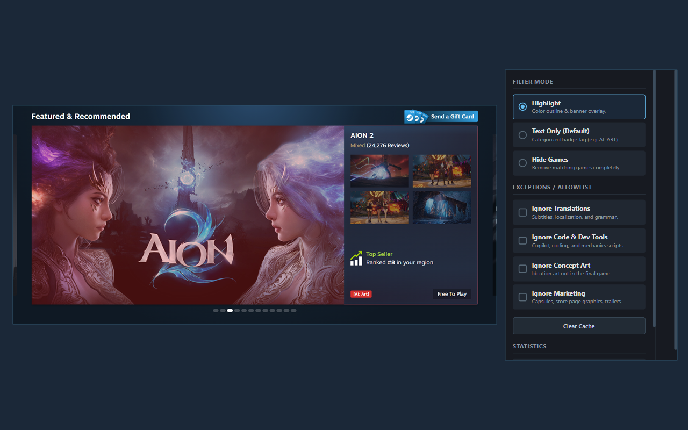
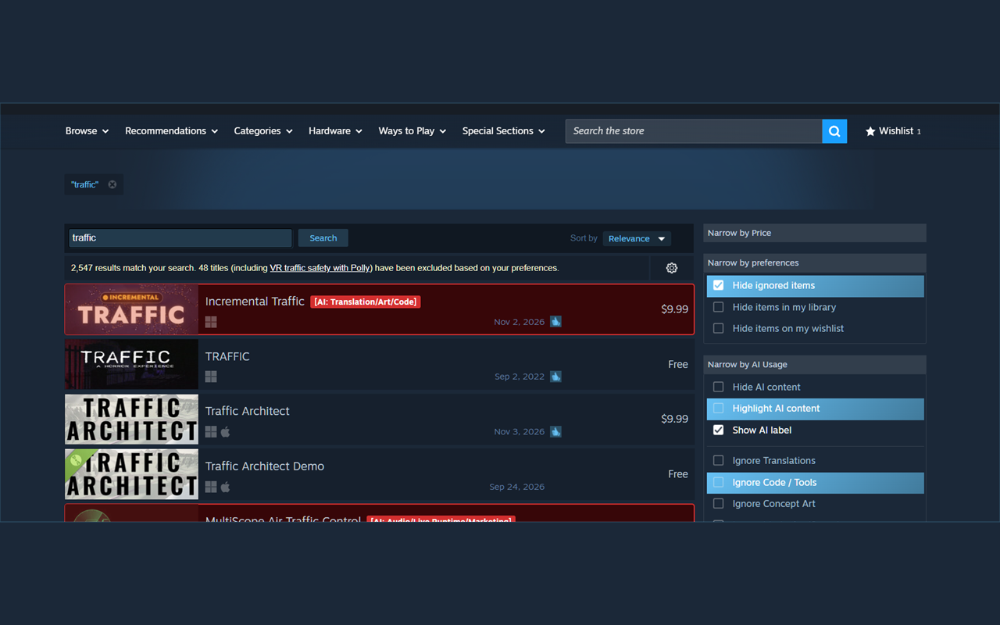
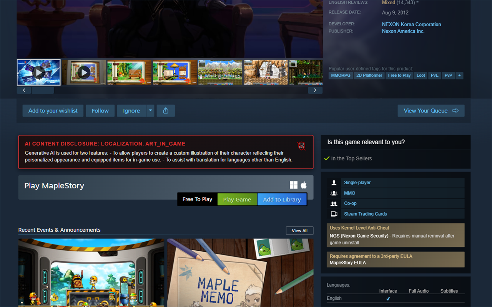
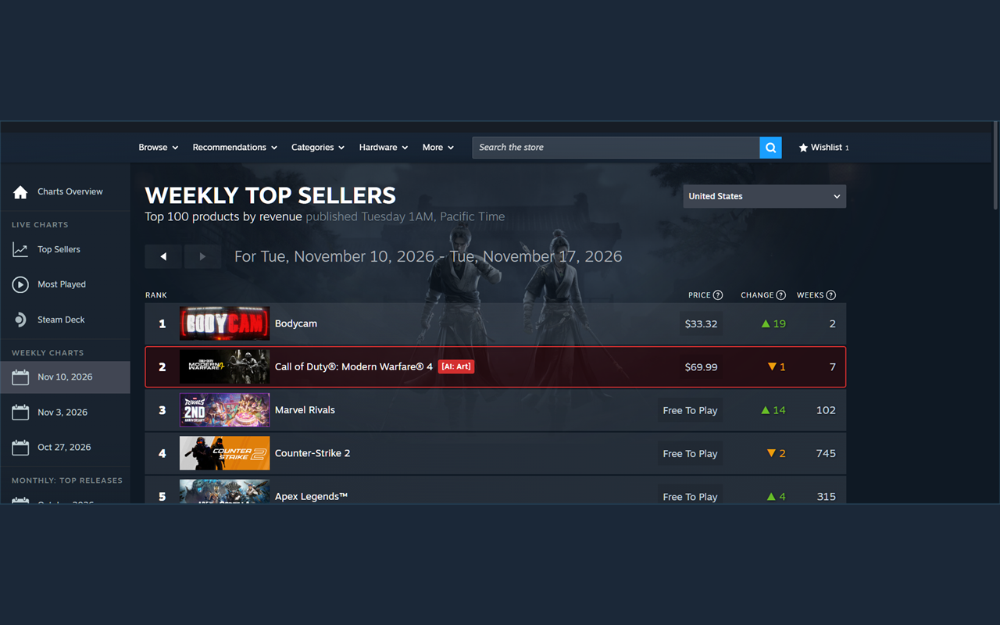
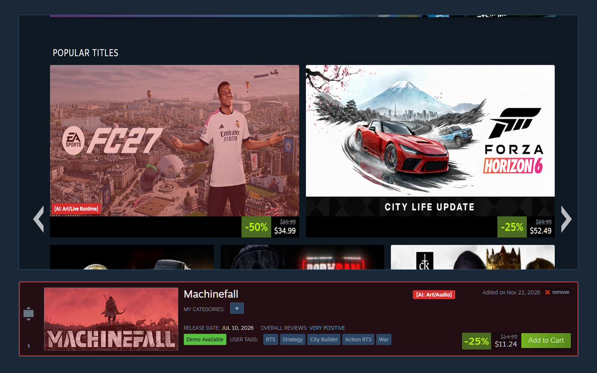

# AI Content Filter for Steam

Valve requires game developers to disclose generative AI usage on Steam, but that disclosure sits buried at the very bottom of product pages. In search results, recommendation carousels, and special sales, it doesn't show up at all.

This browser extension surfaces those disclosures directly while you browse. It tags, highlights, or hides games that disclose AI content so you know what you are looking at before clicking or buying.

## What it does

- Flags AI disclosures across Steam store search results, category sales, specials, discovery queues, recommendation feeds, wishlists, and store pages.
- Gives you three display modes:
  - **Highlight**: Adds a colored outline, category label, and visual tint to game capsules.
  - **Show label**: Displays clean text badges (such as `[AI: Art]` or `[AI: Story]`) without changing existing store colors.
  - **Hide**: Removes flagged titles from search results and browsing feeds completely.
- Breaks disclosures down by type. The extension parses disclosures into specific categories: in-game art, audio and voice acting, written text, code, promotional marketing, live runtime generation, translation, and early concept art.
- Lets you set custom tolerances. If you do not mind machine translation or early concept art, you can toggle them off in the settings so those games stay untagged.
- Identifies Early Access and upcoming releases with a distinct purple theme and separate exemption toggles.
- Runs entirely in your browser. All checks hit Steam's public store APIs directly and store results locally for seven days. No external servers, no tracking scripts, and no telemetry.

## Installation

Install the extension directly from the official web stores:

- [Chrome Web Store](https://chromewebstore.google.com/detail/ai-generated-content-filt/fgkeoeoibigdcdkfdckkpodhfhppgdlo?authuser=0&hl=en)
- [Firefox Add-ons](https://addons.mozilla.org/en-US/firefox/addon/ai-content-filter-for-steam/)

### Steam Desktop Client (Millennium)

If you use the [Millennium](https://millennium.app) patcher for the Steam desktop client, a native plugin version is included in the `millennium-steam-ai-filter` directory.

## How it works

The extension queries Steam's batch browsing API (`IStoreBrowseService`) in chunks of up to 100 games at a time. It inspects the structured survey disclosures submitted by developers and caches classifications locally in browser storage. If a game's metadata is missing from the batch index, the extension streams the store page HTML in the background just far enough to read the content descriptor before aborting the download.

## Screenshots

### Homepage & Options Menu
Outlines featured banners and anchors category badges next to the price block. The options popup lets you choose viewing modes and toggle category exemptions.

### Search Engine & Sidebar Filters
Highlights flagged results and adds a dedicated filter block to the search sidebar.

### Store Product Pages
Displays a warning banner above the purchase container and appends category tags directly to the game title.

### Steam Charts
Outlines entire chart rows across all columns with badges positioned next to titles.

### Category Sale Hubs & Wishlists
Applies visual tints and badges across React sale widgets and modern wishlist entries.

## Support & Feedback

If you find a disclosure that was parsed incorrectly or encounter a layout bug on Steam, please report an issue on GitHub or email extensions@iren.blue.
